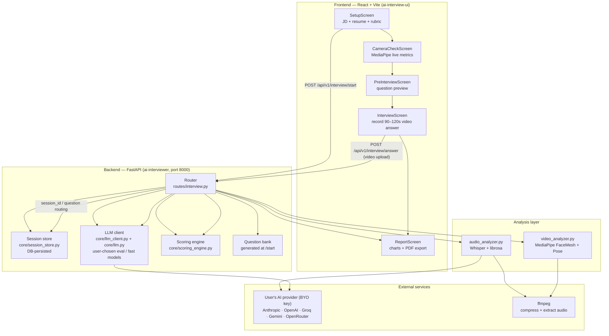
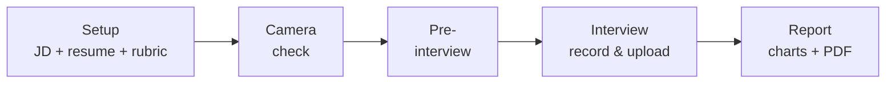
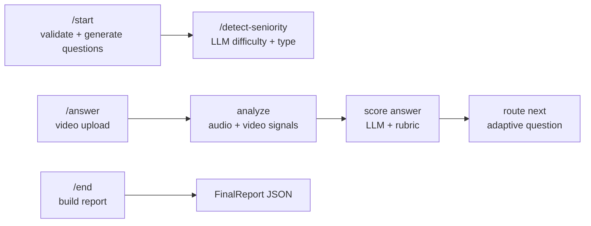
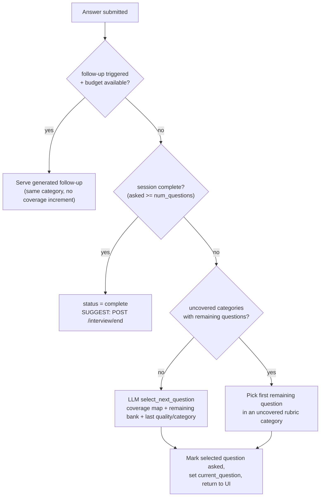
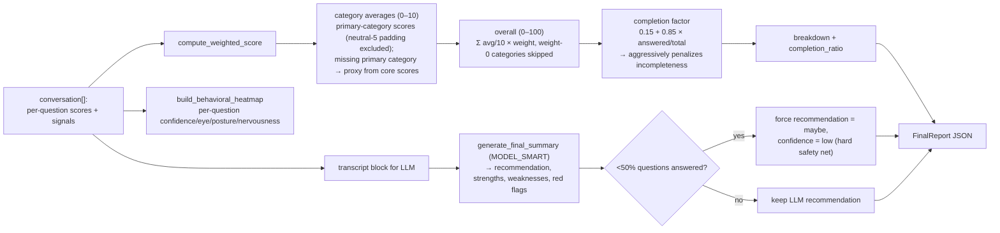

# AI Interviewer

An end-to-end **AI interview practice platform**. A candidate pastes a **job description**, uploads a **resume**, and is interviewed on video by an AI that generates **adaptive, role-tailored questions** — then receives a detailed performance report scored on **content, audio behavior, and video behavior**.

> **Repository layout** — this project ships as **two folders in one repo**:
> - `ai-interviewer/` — the FastAPI **backend** (LLM orchestration, scoring, analysis)
> - `ai-interview-ui/` — the React + Vite **frontend** (browser app)

---

## Table of contents

1. [Highlights](#highlights)
2. [Features](#features)
3. [System architecture](#system-architecture)
4. [Frontend & backend flows](#frontend-flow)
5. [How an answer is processed](#how-an-answer-is-processed)
6. [Adaptive question routing](#adaptive-question-routing)
7. [Session lifecycle](#session-lifecycle)
8. [Scoring & report generation](#scoring--report-generation)
9. [Tech stack](#tech-stack)
10. [Repository structure](#repository-structure)
11. [Prerequisites](#prerequisites)
12. [Setup — Backend](#setup--backend)
13. [Setup — Frontend](#setup--frontend)
14. [First run](#first-run)
15. [Production & deployment](#production--deployment)
16. [API reference](#api-reference)
17. [Environment variables](#environment-variables)
18. [Troubleshooting](#troubleshooting)

---

## Highlights

- The AI **reads the job description and resume**, detects seniority + interview type, and generates a tailored question bank.
- Every answer is analyzed from **three angles**:
  - **Content** — what was said (transcript, relevancy, depth, examples)
  - **Audio behavior** — pace (WPM), filler words, hedging, pauses, confidence of language
  - **Video behavior** — eye contact, posture, gesturing, facial expressions, nervousness indicators, drowsiness
- Every answer is scored against a **weighted rubric**, the next question is chosen **adaptively** based on coverage gaps, and **weak answers trigger follow-up probes**.
- A full report is generated with an overall score, hire/no-hire/maybe recommendation, strengths/weaknesses/red-flags and a behavioral heatmap.

---

## Features

- **Role-tailored question generation** — LLM builds questions matching the job, the candidate's resume, difficulty and interview type, with per-category counts driven by the rubric weights (every weight>0 category is guaranteed coverage).
- **Automatic seniority detection** — the setup screen calls `/detect-seniority` and pre-selects junior / mid / senior difficulty.
- **Live video recording** in the browser via `MediaPipe`-based camera checks (gaze, posture, lighting).
- **Audio-only fallback** — if the webcam fails or is denied, the interview continues in audio mode (mic-only recording, video analysis skipped) instead of blocking the session.
- **Adaptive question selection** — the AI picks the next question based on rubric coverage gaps and how well the last answer went.
- **Dynamic follow-ups** — weak or suspicious answers get an immediate, in-topic probing question.
- **Real signal extraction**:
  - Transcription with the user's chosen speech-to-text model + technical-term autocorrection
  - librosa audio analysis (pace, pauses, fillers, hedging, confidence language)
  - MediaPipe face/pose analysis (eye contact, expressions, posture, gestures, fatigue)
- **Weighted rubric scoring** per rubric category, with a completion factor that penalizes incomplete interviews.
- **Detailed PDF report** export (dark-themed, jsPDF) and per-question charts.
- **Resume/"resume" URL** — a refresh of the interview page lets you resume an in-progress session (localStorage).

---

## System architecture



---

## Frontend flow



The interview screen loops: record answer → `POST /interview/answer` → backend returns the next question (or follow-up, or "complete").

## Backend flow



Parallel flow: `/detect-seniority` runs at setup; `/start` creates the session; each `/answer` runs analyze → score → route; `/end` produces the report.

---

## How an answer is processed

Every submitted video goes through a strict 4-step pipeline. Files are temporarily written to disk and cleaned up afterwards. If the candidate records audio-only (webcam unavailable), the video compression and MediaPipe steps are skipped — the raw audio is converted to WAV and analyzed directly.

```mermaid
flowchart TD
    A["Candidate video<br/>(webm/mp4 upload)"] --> B["[0/4] _compress_video<br/>ffmpeg scale=640:480 crf=28"]
    B --> C["[1/4] _extract_audio<br/>ffmpeg → 16kHz mono WAV"]
    C --> D["[2/4] audio_analyzer<br/>user's STT model → transcript<br/>librosa → WPM, pauses, fillers, hedging, confidence"]
    D --> E["[3/4] video_analyzer<br/>MediaPipe FaceLandmarker + Pose<br/>→ eye contact %, posture, expressions, gestures, fatigue"]
    E --> F["[4/4] scoring_engine<br/>semantic similarity + LLM per-answer score"]

    F --> G{"answer quality"}
    G -- "silent / < 3 words" --> H["Score 0, anomaly_flagged,<br/>justification: no_speech_detected"]
    G -- "weak (<5 content)" --> I["follow_up_triggered=true<br/>generate_adaptive_followup"]
    G -- "good" --> J["store conversation entry<br/>increment topic_coverage"]
    I --> K["synthesize follow-up question<br/>id = max_id + 1, is_follow_up"]
    K --> L["return next question to UI"]

    subgraph LLM["LLM calls (user's models)"]
        M["score_answer (MODEL_SMART)"]
        N["generate_adaptive_followup (MODEL_FAST)"]
        O["select_next_question (MODEL_FAST)"]
    end
    F --> M
    I --> N
    G --> O
```

<details>
<summary>Expand pipeline diagram</summary>



</details>

---

## Adaptive question routing

The backend never picks the next question blindly — it combines **rubric coverage**, **remaining questions**, and the **quality of the last answer**.

<details>
<summary>Expand routing diagram</summary>



</details>

- **Follow-up budget** = not yet at the question limit AND bank still has non-follow-up questions.

---

## Session lifecycle

```mermaid
stateDiagram-v2
    [*] --> created: POST /interview/start
    created --> ongoing: first question returned (marked asked)
    ongoing --> ongoing: answer / skip submitted; next question routed
    ongoing --> complete: all planned questions exhausted
    complete --> reported: POST /interview/end builds report
    reported --> [*]: session deleted from store after report

    note right of created
        session created (persisted to DB) with
        meta, question_bank, topic_coverage
        (started = 0 for every rubric category)
    end note

    note right of ongoing
        conversation[] grows with each entry;
        topic_coverage incremented only on
        non-follow-up answers/skips
    end note
```

<details>
<summary>Expand lifecycle diagram</summary>



</details>

---

## Scoring & report generation

<details>
<summary>Expand scoring diagram</summary>



</details>

**Default rubric** (weights must sum to 100):

| Category | Weight |
|---|---|
| technical_depth | 35 |
| problem_solving | 25 |
| communication_clarity | 20 |
| confidence | 10 |
| cultural_fit | 10 |

Rubric weights drive the whole interview:

- **Question coverage is guaranteed** — the question bank is built with exact per-category counts derived from the weights, so every category with weight > 0 gets at least one question (extra questions go to the highest-weight categories first). If the LLM misses a promised category, a targeted single-question **backfill** generates one.
- **Weight-0 categories are opted out** — no question is generated for them and they never appear as stray 0-score cards in the report breakdown.
- **Primary-category safety net** — if a scorer omits a question's own category, it is derived from the core content/communication/confidence scores, so a strong answer can't silently score its own category 0.

Beyond that, scoring is intentionally conservative: **untested categories count as 0** (no rescaling), and a mid-interview skip or silent answer scores zero with a clear justification.

---

## Tech stack

**Backend** (`ai-interviewer/`)
- Python 3.12 · FastAPI · uvicorn · SQLAlchemy 2 (SQLite by default, Postgres in production)
- **Bring-your-own-key LLMs** — Anthropic (official `anthropic` SDK), OpenAI, Groq, Google Gemini and OpenRouter (via the `openai` SDK's compatible endpoints). Users choose separate **evaluation**, optional **fast/routing** and **transcription** models.
- Speech-to-text — Groq / OpenAI Whisper-family (`whisper-large-v3-turbo`, `gpt-transcribe`, …) or an audio-capable Gemini / OpenRouter chat model
- Passwordless email OTP sign-in via **Brevo**; httpOnly server-side sessions; provider keys encrypted at rest (Fernet)
- MediaPipe FaceLandmarker + PoseLandmarker · OpenCV · NumPy · librosa · sentence-transformers (optional) · ffmpeg (binary, `PATH`)

**Frontend** (`ai-interview-ui/`)
- React 19 + TypeScript + Vite · Tailwind CSS v4 (dark UI) · framer-motion
- Landing page, OTP login, Settings (API keys + model pickers), interview flow
- MediaPipe FaceMesh (live camera metrics) · jsPDF (PDF export) · Recharts

---

## Repository structure

### Backend — `ai-interviewer/`

| Path | Purpose |
|---|---|
| `main.py` | FastAPI app: startup (create tables, purge stale sessions), CORS, CSRF header check, security headers, `AIError` handler, routers at `/api/v1`, serves the built frontend with SPA fallback. |
| `routes/auth.py` | `/auth/request-otp`, `/auth/verify-otp`, `/auth/logout`, `/auth/me` (GET/PATCH). Per-email + per-IP rate limits, attempt limits, single-use codes. |
| `routes/account.py` | `/account/ai` (status + model choices), `/account/keys/{provider}` (verify → encrypt → store / delete), `/account/models/{provider}` (live model list), `DELETE /account`. |
| `routes/interview.py` | `/start`, `/detect-seniority`, `/answer`, `/skip`, `/end` — all require sign-in and session ownership; run in FastAPI's threadpool. |
| `core/config.py` | Environment config; refuses to start in `ENV=production` without secrets. |
| `core/db.py` | SQLAlchemy models: users, OTP codes, auth sessions, provider keys, user settings, interview sessions, usage events (daily quota), finished reports. |
| `core/llm.py` | Provider registry, JSON chat calls, transcription, error translation, model discovery/validation. |
| `core/llm_client.py` | Interview prompts → LLM calls with retry/truncation handling (question generation + backfill, scoring, follow-ups, routing, summary, seniority). |
| `core/ai_settings.py` | Loads a user's keys + model choices into an `AIConfig` for the request. |
| `core/session_store.py` | Interview state, write-through persisted to the DB (survives restarts). |
| `core/email.py` · `core/security.py` · `core/deps.py` | Brevo email, hashing/encryption helpers, `current_user` dependency. |
| `analysis/audio_analyzer.py` | Transcription via the user's STT model, WPM, pauses, fillers, hedging, confidence-language score. |
| `analysis/video_analyzer.py` | MediaPipe face + pose analysis: eye contact, expressions, posture, gestures, nervousness, drowsiness, engagement. |
| `prompts/templates.py` | All LLM prompt templates. |
| `models/schemas.py` | Pydantic request/response models. |

### Frontend — `ai-interview-ui/`

| Path | Purpose |
|---|---|
| `src/App.tsx` | Page routing (`/`, `/login`, `/app`, `/settings`) + auth guard. |
| `src/InterviewApp.tsx` | Interview state machine (`setup → camera-check → pre-interview → interview → report`). |
| `src/pages/LandingPage.tsx` · `LoginPage.tsx` · `SettingsPage.tsx` | Marketing page, email-code sign-in, keys/models/profile/account deletion. |
| `src/lib/api.ts` · `auth.tsx` · `account-api.ts` · `router.tsx` | Fetch wrapper (cookies + CSRF header), auth context, account endpoints, tiny router. |
| `src/lib/interview-api.ts` | Interview endpoints. |
| `src/components/interview/*` | Setup, camera check, pre-interview, interview, report screens. |

---

## Prerequisites

| Tool | Version | Install |
|---|---|---|
| Git | any | https://git-scm.com |
| Python | 3.12 | https://www.python.org/downloads/ (Windows: tick "Add python.exe to PATH") |
| Node.js | 22+ | https://nodejs.org |
| ffmpeg | any recent | Windows: `winget install Gyan.FFmpeg` · macOS: `brew install ffmpeg` · Ubuntu/Debian: `sudo apt install ffmpeg` |
| An AI provider key | — | At least one of Groq, OpenAI, Gemini, OpenRouter or Anthropic. All but Anthropic can also transcribe audio. Groq and Gemini have free tiers. |

Check with `python --version`, `node --version` and `ffmpeg -version` in a new terminal.

```bash
git clone https://github.com/RishabhPR77/ai-interview.git
cd ai-interview
```

## Setup — Backend

```bash
cd ai-interviewer
python -m venv venv
venv\Scripts\activate            # Windows; use `source venv/bin/activate` on Unix
pip install -r requirements.txt
cp .env.example .env             # (cmd.exe: copy) — all values optional in development
uvicorn main:app --port 8000 --reload
```

- In development, `SECRET_KEY` / `ENCRYPTION_KEY` are generated under `ai-interviewer/data/`, and without `BREVO_API_KEY` the **sign-in code is printed in the server console**.
- **ffmpeg is required** on `PATH`. The MediaPipe face and pose models (~10MB) download to `~/.cache/mediapipe` on first use.
- No server-side LLM key is needed — each user adds their own in **Settings**.

## Setup — Frontend

```bash
cd ai-interview-ui
npm install
npm run dev        # → http://localhost:5173 (proxies /api to 127.0.0.1:8000)
```

Leave `VITE_API_URL` unset in development: the Vite proxy keeps the API same-origin so the session cookie works.

## First run

Keep both terminals (backend on :8000, frontend on :5173) running, then:

1. Open http://localhost:5173 → **Get started**.
2. Enter any email. Without `BREVO_API_KEY` no email is sent — the 6-digit code is printed in the **backend terminal** (`[dev] OTP for you@example.com: 123456`).
3. Enter the code and your name. You land in **Settings**.
4. Paste a provider key and click **Verify & save** — it's checked, encrypted and sensible default models are picked. Anthropic can't transcribe audio, so with an Anthropic key also add a Groq, OpenAI, Gemini or OpenRouter key for the transcription model.
5. Click **Start practicing** (or *Practice interview* in the account menu), paste a job description and resume, allow camera + microphone, and answer. The report appears when you finish.

## Production & deployment

The repo-root `Dockerfile` builds one image that serves the API and the built web app from the same origin (no CORS, cookie stays same-site):

```bash
docker build -t tejaskrit .
docker run -p 8000:8000 --env-file ai-interviewer/.env -v tk-data:/data tejaskrit
```

It installs ffmpeg and the Python deps, bakes in the MediaPipe models and runs as a non-root user (UID 1000). It reads `PORT` if the host sets one (default 8000) and exposes `/health` for health checks.

**Environment** — with `ENV=production` the server refuses to start until all of these except `DATABASE_URL` are set:

| Variable | Value |
|---|---|
| `ENV` | `production` |
| `APP_URL` | the public `https://` URL users open |
| `SECRET_KEY`, `ENCRYPTION_KEY` | two different random values: `python -c "import secrets; print(secrets.token_urlsafe(48))"` |
| `BREVO_API_KEY` | from Brevo → SMTP & API → API Keys |
| `EMAIL_FROM_ADDRESS` | a sender verified in Brevo |
| `DATABASE_URL` | a Postgres URL (`postgres://` / `postgresql://` both work). Without it, SQLite under `/data` — mount a volume. |

> **Back up `ENCRYPTION_KEY`.** It encrypts users' saved provider keys; if it changes, every stored key becomes unreadable and users must re-enter them.

**What the host must provide**

- **≥ 1 GB RAM** — answer analysis (ffmpeg + MediaPipe) peaks around 550 MB. 512 MB free tiers are too small.
- **Exactly one instance**, always on — interview locks, background answer jobs and the sign-in rate limiter live in the process. Don't enable autoscaling or scale-to-zero.
- **Postgres** (managed or a container next to the app) and **HTTPS** (the session cookie is `Secure` when `APP_URL` is `https`).

**Where to host it**

- **Railway / Render / Fly.io / DigitalOcean App Platform** — deploy the GitHub repo (the root `Dockerfile` is detected), add the host's Postgres, set the variables above, generate a public domain, set the health check path to `/health`, keep one replica. On Railway, use `DATABASE_URL=${{Postgres.DATABASE_URL}}` and `APP_URL=https://${{RAILWAY_PUBLIC_DOMAIN}}`; don't set `PORT` yourself.
- **Azure for Students (free, no card)** — what the live deployment runs on. The offer gives $100 credit plus 12 months of a free `Standard_B2ats_v2` VM (2 vCPU, 1 GB). Sign up at https://azure.microsoft.com/free/students; if your college email isn't accepted, the GitHub Student Developer Pack unlocks the same offer.
  1. **Pick a region the AI providers serve.** Student subscriptions only allow a few regions (Portal → Policy → Assignments → *Allowed resource deployment regions*), and the free size isn't offered in all of them. Avoid Hong Kong (`eastasia`): Groq, OpenAI and Anthropic refuse requests from there. Korea Central works.
  2. **Create the VM** — Ubuntu Server 24.04 x64, size `Standard_B2ats_v2`, SSH key login, inbound ports 22/80/443, 64 GB Premium SSD, and a DNS name label on its public IP. [`deploy/azure/create-vm-korea.sh`](deploy/azure/create-vm-korea.sh) does all of this in one Cloud Shell command (replace the SSH public key and DNS label with your own).
  3. **On the VM**, clone the repo and run the setup script. It adds 4 GB swap, installs Docker, writes `deploy/azure/.env` with generated secrets (asks for the domain, Brevo key and sender), and starts the app + Postgres + Caddy with automatic HTTPS:

     ```bash
     git clone https://github.com/RishabhPR77/ai-interview.git && cd ai-interview
     bash deploy/azure/setup.sh
     ```

  4. Back up `ENCRYPTION_KEY` from `deploy/azure/.env`. To update later: `git pull && cd deploy/azure && sudo docker compose up -d --build`.
- **Any VPS** (Hetzner, DigitalOcean, Oracle Cloud's free Arm VM, …) — the same `deploy/azure` stack works on any Ubuntu server with Docker: run `bash deploy/azure/setup.sh` with your domain pointed at the server.
- **Hugging Face Spaces** — Docker Spaces need a paid PRO plan since mid-2026. Spaces can only make outbound connections on ports 80, 443 and 8080, so **an external Postgres (port 5432) is unreachable**: leave `DATABASE_URL` unset and the app uses SQLite under `/data`. That data is wiped on every restart unless you attach a storage bucket mounted at `/data`. With PRO: create a *public* Docker Space, add the variables as Space secrets (`APP_URL=https://<user>-<space>.hf.space`), then deploy the committed code:

  ```bash
  pip install -U huggingface_hub && hf auth login
  python deploy/hf_space.py <user>/<space>
  ```

  Open the app at the `*.hf.space` URL — the huggingface.co Space page embeds it in a frame, where the sign-in cookie can't be set.

**After deploying:** sign in with a real email, add a provider key, and run one short interview with the camera on. Optionally add Cloudflare Turnstile (`TURNSTILE_SITE_KEY` + `TURNSTILE_SECRET_KEY`, widget hostname = your domain) to protect sign-in from bots.

---

## API reference

All routes are under `/api/v1`. State-changing requests must send `X-Requested-With: tejaskrit`; authenticated routes use the `tk_session` httpOnly cookie.

| Method | Path | Body | Returns |
|---|---|---|---|
| POST | `/auth/request-otp` | `{email, turnstile_token?}` | `{ok, expires_in_seconds, resend_after_seconds}` |
| POST | `/auth/verify-otp` | `{email, code}` | `{user, is_new}` + sets session cookie |
| POST | `/auth/logout` | — | revokes the session |
| GET / PATCH | `/auth/me` | PATCH: `{name}` | `{user}` |
| GET / PUT | `/account/ai` | PUT: `{eval_provider, eval_model, fast_provider, fast_model, stt_provider, stt_model}` | providers, selection, `ready` |
| PUT / DELETE | `/account/keys/{provider}` | PUT: `{api_key}` (verified before saving) | updated settings |
| GET | `/account/models/{provider}` | — | `{llm: [...], stt: [...]}` for the saved key |
| DELETE | `/account` | — | deletes account, keys, settings, in-progress interviews |
| POST | `/interview/start` | `job_title`, `job_description`, `candidate_name`, `candidate_resume`, `num_questions`, `interview_type`, `difficulty`, `rubric` | session id + first question (409 `ai_not_configured` if setup incomplete) |
| POST | `/interview/detect-seniority` | `{job_description, resume_text}` | `{difficulty, interview_type, reasoning}` |
| POST | `/interview/answer` | multipart: `session_id`, `question_id`, `video`, `is_audio_only` | `202 {"status":"processing"}` — analysis runs in the background (409 `stale_question` / `answer_processing` for replays or double-submits) |
| GET | `/interview/{session_id}/answer-status?question_id=` | — | `processing`, `error` (+ `detail`, re-submit allowed), or the next question / follow-up / `complete` |
| GET | `/interview/{session_id}/state` | — | current question + status (used to resync) |
| POST | `/interview/{session_id}/skip` | `{question_id}` | next question or complete |
| POST | `/interview/end` | form: `session_id` | final report; the live session is deleted and the report kept for `REPORT_RETENTION_HOURS` (retrying returns the stored report) |
| GET | `/interview/{session_id}/report` | — | a stored report, until it expires |
| GET | `/auth/config` | — | `{turnstile_site_key}` for the sign-in page |
| GET | `/health` | — | `{status, ffmpeg}` |

---

## Environment variables

See [`ai-interviewer/.env.example`](ai-interviewer/.env.example) for the full list.

| Variable | Purpose |
|---|---|
| `ENV` | `production` enforces secrets, hides `/docs` |
| `APP_URL` | Public URL (emails, Secure cookie detection) |
| `SECRET_KEY` | Signs OTP hashes |
| `ENCRYPTION_KEY` | Encrypts users' provider keys — back it up |
| `DATABASE_URL` | Postgres URL in production (SQLite default) |
| `BREVO_API_KEY`, `EMAIL_FROM_ADDRESS`, `EMAIL_FROM_NAME` | Sign-in emails |
| `TURNSTILE_SITE_KEY`, `TURNSTILE_SECRET_KEY` | Cloudflare Turnstile bot check on sign-in (both or neither) |
| `MAX_INTERVIEWS_PER_DAY`, `MAX_ANSWER_SECONDS` | Per-user daily interview quota; longest answer analysed |
| `REPORT_RETENTION_HOURS` | How long a finished report can be reopened (default 24) |
| `ANALYSIS_WORKERS` | Parallel answer analyses per server |
| `COOKIE_SAMESITE`, `CORS_ORIGINS` | Only for split frontend/backend hosting |
| `MAX_UPLOAD_MB`, `LOCAL_WHISPER_FALLBACK` | Upload cap (default 100); optional offline Whisper (`requirements-local-whisper.txt`) |

---

## Troubleshooting

- **"Your … API key was rejected"** — the key is invalid or revoked; replace it in Settings.
- **"model not found"** — pick a model from the live list in Settings (it only shows models your key can use).
- **Didn't get the sign-in email** — in development the code is in the backend console; in production check the Brevo sender is verified and look at Brevo's transactional logs.
- **401 loops in development** — don't set `VITE_API_URL`; use the Vite proxy so the cookie is same-origin.
- **Audio not transcribed** — check ffmpeg is on `PATH` and the transcription model in Settings.
- **No faces detected in video** — camera too dark or face off-frame; that answer is scored on content and audio only and the report shows video metrics as unavailable.
- **`ffmpeg` not found after installing it** — open a new terminal so the updated `PATH` is picked up; `/health` reports `"ffmpeg": true` when the server can see it.
- **Server won't start with `ENV=production`** — the error names the missing variable (see [Production & deployment](#production--deployment)).
