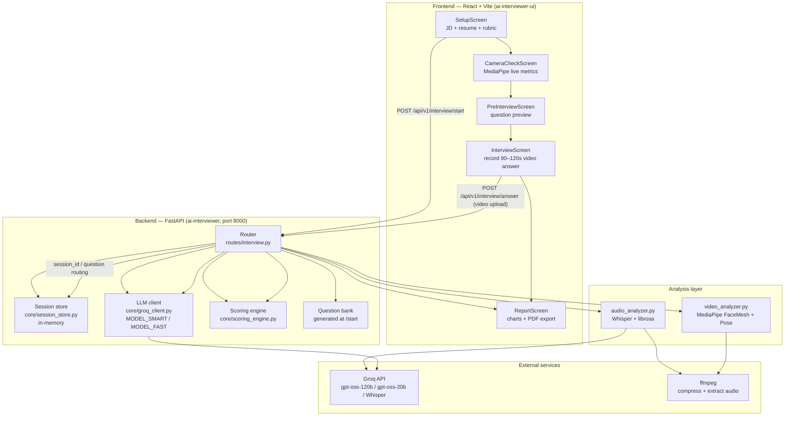
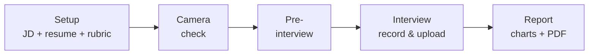
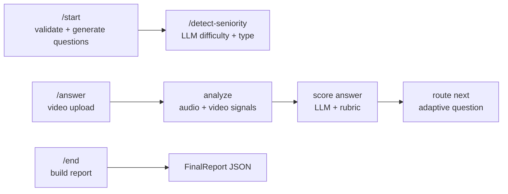
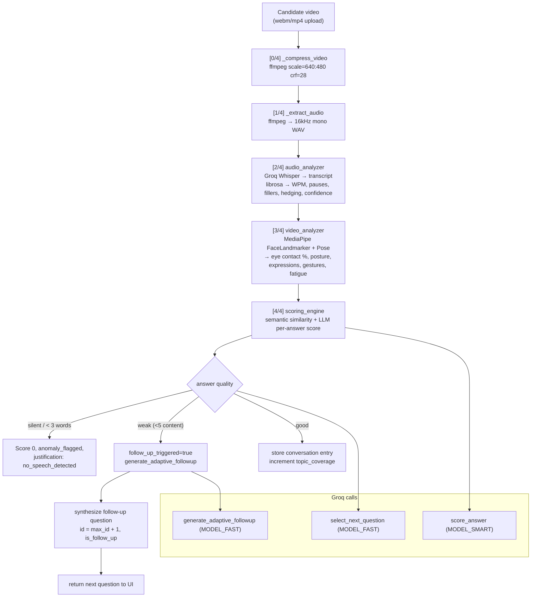
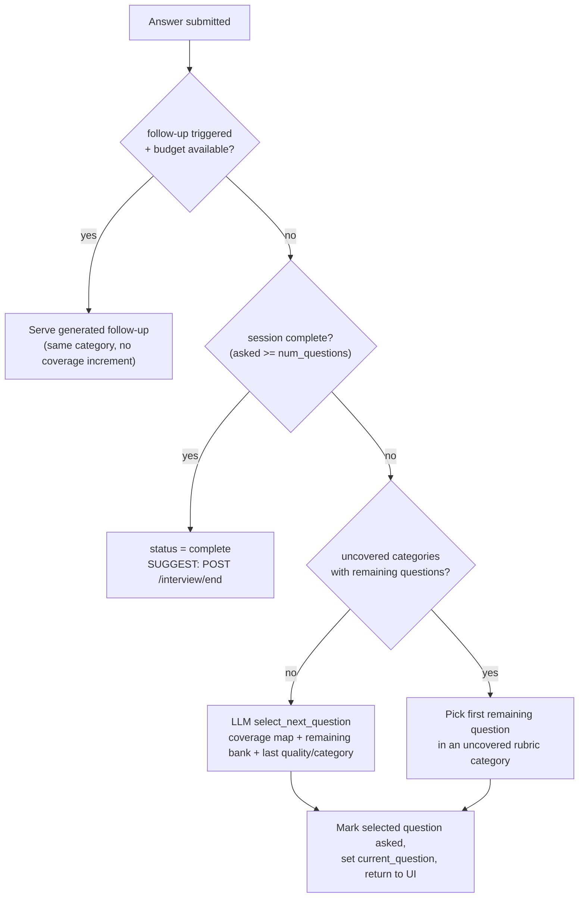
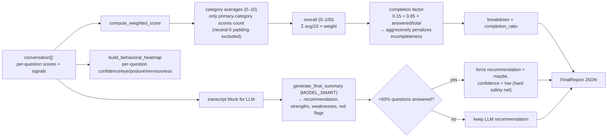

# AI Interviewer

An end-to-end **AI interview practice platform**. A candidate pastes a **job description**, uploads a **resume**, and is interviewed on video by an AI that generates **adaptive, role-tailored questions** — then receives a detailed performance report scored on **content, audio behavior, and video behavior**.

> **Repository layout** — this project ships as **two folders in one repo**:
> - `ai-interviewer/` — the FastAPI **backend** (LLM orchestration, scoring, analysis)
> - `ai-interviewer-ui/` — the React + Vite **frontend** (browser app)

---

## Table of contents

1. [Highlights](#highlights)
2. [Features](#features)
3. [System architecture](#system-architecture)
4. [Frontend & backend flows](#frontend-flow)
5. [How an answer is processed](#how-an-answer-is-processed)
6. [Adaptive question routing](#adaptive-question-routing)
7. [Session lifecycle](#session-lifecycle)
8. [Scoring & report generation](#scoring--report-generation)
9. [Tech stack](#tech-stack)
10. [Repository structure](#repository-structure)
11. [Setup — Backend](#setup--backend)
12. [Setup — Frontend](#setup--frontend)
13. [API reference](#api-reference)
14. [Environment variables](#environment-variables)
15. [Troubleshooting](#troubleshooting)

---

## Highlights

- The AI **reads the job description and resume**, detects seniority + interview type, and generates a tailored question bank.
- Every answer is analyzed from **three angles**:
  - **Content** — what was said (transcript, relevancy, depth, examples)
  - **Audio behavior** — pace (WPM), filler words, hedging, pauses, confidence of language
  - **Video behavior** — eye contact, posture, gesturing, facial expressions, nervousness indicators, drowsiness
- Every answer is scored against a **weighted rubric**, the next question is chosen **adaptively** based on coverage gaps, and **weak answers trigger follow-up probes**.
- A full report is generated with an overall score, hire/no-hire/maybe recommendation, strengths/weaknesses/red-flags and a behavioral heatmap.

---

## Features

- **Role-tailored question generation** — LLM builds questions matching the job, the candidate's resume, difficulty and interview type.
- **Automatic seniority detection** — the setup screen calls `/detect-seniority` and pre-selects junior / mid / senior difficulty.
- **Live video recording** in the browser via `MediaPipe`-based camera checks (gaze, posture, lighting).
- **Adaptive question selection** — the AI picks the next question based on rubric coverage gaps and how well the last answer went.
- **Dynamic follow-ups** — weak or suspicious answers get an immediate, in-topic probing question.
- **Real signal extraction**:
  - Whisper transcription (Groq, with local fallback) + technical-term autocorrection
  - librosa audio analysis (pace, pauses, fillers, hedging, confidence language)
  - MediaPipe face/pose analysis (eye contact, expressions, posture, gestures, fatigue)
- **Weighted rubric scoring** per rubric category, with a completion factor that penalizes incomplete interviews.
- **Detailed PDF report** export (dark-themed, jsPDF) and per-question charts.
- **Resume/"resume" URL** — a refresh of the interview page lets you resume an in-progress session (localStorage).

---

## System architecture



---

## Frontend flow



The interview screen loops: record answer → `POST /interview/answer` → backend returns the next question (or follow-up, or "complete").

## Backend flow



Parallel flow: `/detect-seniority` runs at setup; `/start` creates the session; each `/answer` runs analyze → score → route; `/end` produces the report.

---

## How an answer is processed

Every submitted video goes through a strict 4-step pipeline. Files are temporarily written to disk and cleaned up afterwards.

<details>
<summary>Expand pipeline diagram</summary>



</details>

---

## Adaptive question routing

The backend never picks the next question blindly — it combines **rubric coverage**, **remaining questions**, and the **quality of the last answer**.

<details>
<summary>Expand routing diagram</summary>



</details>

- **Follow-up budget** = not yet at the question limit AND bank still has non-follow-up questions.

---

## Session lifecycle

```mermaid
stateDiagram-v2
    [*] --> created: POST /interview/start
    created --> ongoing: first question returned (marked asked)
    ongoing --> ongoing: answer / skip submitted; next question routed
    ongoing --> complete: all planned questions exhausted
    complete --> reported: POST /interview/end builds report
    reported --> [*]: session deleted from store after report

    note right of created
        session created in-memory with
        meta, question_bank, topic_coverage
        (started = 0 for every rubric category)
    end note

    note right of ongoing
        conversation[] grows with each entry;
        topic_coverage incremented only on
        non-follow-up answers/skips
    end note
```

<details>
<summary>Expand lifecycle diagram</summary>



</details>

---

## Scoring & report generation

<details>
<summary>Expand scoring diagram</summary>



</details>

**Default rubric** (weights must sum to 100):

| Category | Weight |
|---|---|
| technical_depth | 35 |
| problem_solving | 25 |
| communication_clarity | 20 |
| confidence | 10 |
| cultural_fit | 10 |

Scoring is intentionally conservative: **untested categories count as 0** (no rescaling), and a mid-interview skip or silent answer scores zero with a clear justification.

---

## Tech stack

**Backend** (`ai-interviewer/`)
- Python 3.12 · FastAPI · uvicorn
- Groq API — `openai/gpt-oss-120b` (scoring/generation), `openai/gpt-oss-20b` (routing), `whisper-large-v3-turbo` (transcription)
- MediaPipe (FaceLandmarker + Pose) · OpenCV · NumPy · librosa · sentence-transformers (optional)
- Local Whisper fallback · ffmpeg (binary, `PATH`)

**Frontend** (`ai-interviewer-ui/`)
- React 18 + TypeScript + Vite
- Tailwind CSS (dark UI)
- `@mediapipe/tasks-vision` (live camera metrics) · jsPDF (PDF report export)
- Recharts-style charts for performance breakdown

---

## Repository structure

### Backend — `ai-interviewer/`

| Path | Purpose |
|---|---|
| `main.py` | FastAPI entrypoint. Loads `.env`, mounts CORS, includes router at `/api/v1`. `GET /` and `GET /health`. |
| `routes/interview.py` | **All endpoints.** `/start`, `/detect-seniority`, `/answer`, `/skip`, `/end`; ffmpeg compress + audio extract; follow-up synthesis; next-question routing. |
| `core/groq_client.py` | LLM layer. `_call_groq` (3 retries, JSON-only, code-fence stripping), question generation, per-answer scoring, follow-up generation, next-question selection, final summary, seniority detection. |
| `core/scoring_engine.py` | Weighted rubric scoring, semantic similarity, behavioral heatmap, per-answer score assembly, final report assembly + LLM summary + hard safety net. |
| `core/session_store.py` | In-memory session store (meta, question bank, asked IDs, conversation, topic coverage). |
| `analysis/audio_analyzer.py` | Whisper transcription (Groq → local fallback), tech-term autocorrection, WPM, pause counting, filler/hedging detection, confidence-language score, silent-recording flag. |
| `analysis/video_analyzer.py` | MediaPipe frame-by-frame analysis: eye contact (matrix + iris, glasses-safe), expressions/blendshapes, posture (pose + face matrix), gestures, nervousness, drowsiness/fatigue, event detection, engagement score, expression timeline. |
| `prompts/templates.py` | All LLM prompt templates (question gen, scoring, follow-up, routing, summary). |
| `models/schemas.py` | Pydantic models: `Rubric` (validates sum=100), `StartInterviewRequest/Response`, `AudioSignals`, `VideoSignals`, `QuestionScore`, `FinalReport`. |
| `test_interview.py` | Manual/test helper for exercising the pipeline. |
| `.env` | `GROQ_API_KEY`, `WHISPER_MODEL` (gitignored). |

### Frontend — `ai-interviewer-ui/`

| Path | Purpose |
|---|---|
| `src/App.tsx` | Screen state machine (`setup → camera-check → pre-interview → interview → report`), resume-from-localStorage banner, error toast. |
| `src/lib/interview-api.ts` | Typed API client for all backend endpoints. |
| `src/lib/mediapipe-loader.ts` | Preloads MediaPipe FaceMesh assets from CDN with cache-busting. |
| `src/lib/export-pdf.ts` | jsPDF dark-themed PDF report generation. |
| `src/lib/history.ts` | (empty by design — reserved slot). |
| `src/components/interview/SetupScreen.tsx` | JD + resume input, rubric picker, seniority auto-detect, starts interview. |
| `src/components/interview/CameraCheckScreen.tsx` | Live MediaPipe metrics feel-check before starting (gaze, posture, lighting). |
| `src/components/interview/PreInterviewScreen.tsx` | Shows first question, rubric, checklist/tips. |
| `src/components/interview/InterviewScreen.tsx` | Fullscreen record loop, per-answer upload, session persistence, completion. |
| `src/components/interview/ReportScreen.tsx` | Overall scores, category breakdown, per-question feedback, heatmap, PDF export. |
| `src/components/interview/PerformanceCharts.tsx` | Charts for performance breakdown. |
| `src/components/interview/ComparePanel.tsx` | Candidate comparison UI. |

---

## Setup — Backend

```bash
cd ai-interviewer
python -m venv venv
venv\Scripts\activate            # Windows; use `source venv/bin/activate` on Unix
pip install -r requirements.txt
```

**`.env`** (create inside `ai-interviewer/`, already gitignored):

```
GROQ_API_KEY=your_groq_key_here
WHISPER_MODEL=base
```

> **ffmpeg is required** and must be on `PATH` (`ffmpeg -version` should work). MediaPipe's face landmarker model (~30MB) auto-downloads to `~/​.cache/mediapipe` on first run.

**Run:**

```bash
uvicorn main:app --host 0.0.0.0 --port 8000 --reload
```

Smoke-check: `http://127.0.0.1:8000/health` → `{"status":"ok","groq_key_set":true}`.

---

## Setup — Frontend

```bash
cd ai-interviewer-ui
npm install
npm run dev        # → http://localhost:5173
```

**`.env`** (inside `ai-interviewer-ui/`, gitignored):

```
VITE_API_URL=http://127.0.0.1:8000/api/v1
```

Open the Vite URL, grant camera + mic, and run an interview. MediaPipe FaceMesh loads from CDN on the camera-check screen.

---

## API reference

All routes are under the `/api/v1` prefix (`http://127.0.0.1:8000/api/v1`).

| Method | Path | Body | Returns |
|---|---|---|---|
| GET | `/` | — | service status + endpoint list |
| GET | `/health` | — | `status`, `groq_key_set` |
| POST | `/interview/start` | JSON: `job_title`, `job_description`, `candidate_name`, `candidate_resume`, `num_questions`, `interview_type`, `difficulty`, `rubric` | `StartInterviewResponse` (session_id + first question) |
| POST | `/interview/detect-seniority` | JSON: `job_description`, `resume_text` | `{difficulty, interview_type, reasoning}` |
| POST | `/interview/answer` | multipart: `session_id`, `question_id`, `video` (file) | next question, follow-up, or `{"status":"complete"}` + recent scores |
| POST | `/interview/{session_id}/skip` | JSON: `question_id` | next question or complete |
| POST | `/interview/end` | form: `session_id` | `FinalReport` (score, recommendation, breakdown, heatmap) |

**Example — start:**

```bash
curl -X POST http://127.0.0.1:8000/api/v1/interview/start \
  -H "Content-Type: application/json" \
  -d '{"job_title":"Backend Engineer","job_description":"...","candidate_name":"Alice","candidate_resume":"...","num_questions":6,"difficulty":"mid","rubric":{"technical_depth":35,"problem_solving":25,"communication_clarity":20,"confidence":10,"cultural_fit":10}}'
```

---

## Environment variables

| Variable | Where | Purpose |
|---|---|---|
| `GROQ_API_KEY` | `ai-interviewer/.env` | LLM + Whisper access (required) |
| `WHISPER_MODEL` | `ai-interviewer/.env` | Local fallback Whisper model, e.g. `base` |
| `VITE_API_URL` | `ai-interviewer-ui/.env` | Backend base URL the frontend calls |

---

## Troubleshooting

- **`404 model_not_found` from Groq** — your API key must have access to the models in `core/groq_client.py` (`MODEL_SMART` / `MODEL_FAST`). If the key doesn't, the model names won't resolve and `detect_experience_level` silently falls back to defaults. Update the model constants to models available on your key (check via `https://console.groq.com/keys` / model list).
- **Port stuck / "address already in use"** — an orphaned `uvicorn --reload` child can hold port 8000. Kill leftover python processes (`Get-Process python | Stop-Process -Force` on Windows) and restart.
- **Frontend is 404ing** — make sure the backend is actually up on `127.0.0.1:8000` and `VITE_API_URL` matches.
- **Audio not transcribed** — check ffmpeg is on `PATH`; Groq Whisper falls back to local Whisper (`WHISPER_MODEL`) automatically.
- **No faces detected in video** — camera too dark or face off-frame; the analyzer prints a warning and uses neutral defaults.
- **Low scores for a short interview** — by design. The completion factor `0.15 + 0.85 × (answered/total)` caps incomplete interviews, and untested rubric categories count as 0.